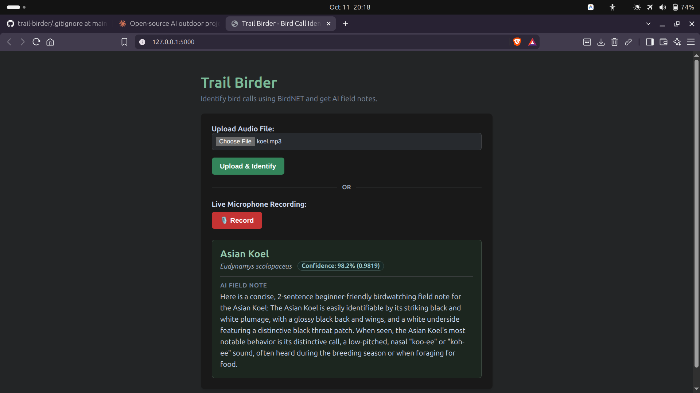

# Trail Birder

Record a bird call and get the species, a confidence score, and a short
field note. It runs fully offline, so it works on a trail with no signal.

## Why open-source AI
- **Offline:** BirdNET (bird sound model) and Llama 3.2 3B (via Ollama)
  both run on my laptop. I tested it with Wi-Fi off.
- **Private:** recordings never leave the device.
- **Free:** no API keys, no usage fees.
- **Swappable:** I can change the language model without touching the rest of the app.
2
## How it works
Browser mic or file upload -> Flask -> ffmpeg converts to WAV ->
BirdNET identifies the species -> Ollama writes a 2-sentence field note.

## How to run
1. `pip install -r requirements.txt`
2. Install ffmpeg and Ollama, then `ollama pull llama3.2:3b`
3. `python app.py` and open http://127.0.0.1:5000

##Test results
| # | Test | Bird | App's answer | Confidence | Wi-Fi |
|---|------|------|--------------|-----------|-------|
| 1 | File upload | Asian Koel | Asian Koel | 0.9819 | On |
| 2 | Mic record | Asian Koel | Asian Koel | 0.9901 | On |
| 3 | File upload | Asian Koel | Asian Koel | 0.9819 | Off |

Hardware: HP ProBook, 14 GB RAM, no GPU.

## Limitations
- Tested on recorded clips, not yet on a live outdoor walk.
- Laptop mics struggle with quiet or noisy recordings.
- BirdNET model files are licensed for non-commercial use.
- The 3B model can invent bird facts, so verify field notes.

## Credits
BirdNET (Cornell Lab / Chemnitz University of Technology), Ollama,
Llama 3.2, and the xeno-canto recordist of my test clip.
